<!-- ============================== HEADER ============================== -->
<a href="https://cadautoscript.com">
  
</a>

<div align="center">

<a href="https://cadautoscript.com">
  
</a>

<br/>

[](https://cadautoscript.com)
[](https://x.com/ymilienin)
[](https://www.linkedin.com/in/yurii-milienin)


<br/>

> ### *I turn engineering know-how into software engineers actually want to use.*

</div>

<br/>

<!-- ============================== ABOUT ============================== -->

## ✦ About me

<table>
<tr>
<td width="55%" valign="top">

For about **a decade** I worked as a **mechanical design and instrumentation & control engineer**: CAD models, process equipment, pressure parts, and the routine paperwork that comes with them.

I kept seeing the same thing: experienced engineers losing hours to spreadsheets, manual checks and copy-paste. So I started building the tools I wished I'd had.

Today I pair that **domain expertise** with **AI coding agents** to ship browser-based calculators, configurators and automation. Agents write a lot of the code. I own the standards, the math and the final call.

</td>
<td width="45%" valign="top">

```ts
const yurii = {
  role:       "Engineer → Full-Stack Dev",
  basedIn:    "Tallinn, Estonia 🇪🇪",
  background: ["Mechanical design", "I&C"],
  building:   [
    "Engineering web tools",
    "Agentic AI workflows",
  ],
  values:     [
    "correct to the standard",
    "fast",
    "privacy-first",
  ],
  openTo:     "collaboration 🤝",
};
```

</td>
</tr>
</table>

<!-- ============================== JOURNEY ============================== -->

<div align="center">

| 📐 **Then** | ⚡ **The shift** | 🚀 **Now** |
| :---: | :---: | :---: |
| Mechanical & I&C engineer:<br/>CAD, process equipment,<br/>engineering documentation | Domain knowledge<br/>+ AI coding agents<br/>= software that ships | Engineering web tools<br/>and agentic AI workflows,<br/>built in public |

</div>

<br/>

<!-- ============================== AGENTIC AI ============================== -->

## ✦ Agentic AI

<table>
<tr>
<td width="50%" valign="top">

### 🔌 [MCP Sandbox](https://github.com/YurMil/Model-Context-Protocol-MCP-sandbox)
Reference architecture, playground and docs hub for connecting LLMs to tools and data through the **Model Context Protocol**.

`MCP` `LLM tooling` `docs`

</td>
<td width="50%" valign="top">

### 📦 [12factor.net-skills](https://github.com/YurMil/12factor.net-skills)
The **twelve-factor app** methodology packaged as agent skills for Claude Code, Cursor, Google Antigravity and any system-prompt assistant.

`agent skills` `best practices`

</td>
</tr>
<tr>
<td width="50%" valign="top">

### 🧠 [AI Skill Hub](https://github.com/YurMil/AI-Skill-Creator)
Local-first web app to **discover, create, validate and export** AI agent skill packages.
🌐 [askillbuilder.com](https://askillbuilder.com)

`web app` `local-first`

</td>
<td width="50%" valign="top">

### 🚗 [Automotive Channel Manager](https://github.com/YurMil/automotive-channel-manager)
Draft **open specification** for workshop capacity, booking and DMS integration.

`open spec` `integration`

</td>
</tr>
</table>

<!-- ============================== ENGINEERING TOOLS ============================== -->

## ✦ Engineering web tools

<p>
  <a href="https://cadautoscript.com"><b>cadautoscript.com</b></a> is a knowledge base and a set of <b>client-side utilities</b> for mechanical design, fabrication, QA and CAD automation.
  Everything runs in your browser, and no project data leaves your machine.
  <sub>(<a href="https://github.com/YurMil/cadautoscript.com">source</a>)</sub>
</p>

<table>
<tr>
<td width="33%" valign="top">

**🔩 [Blind Flange Calculator](https://cadautoscript.com/utilities/blind-flange-calculator/)**<br/>
<sub>PN class per EN 1092-1, minimum thickness per EN 13445-3</sub>

</td>
<td width="33%" valign="top">

**⚡ [Busbar Calculator](https://cadautoscript.com/utilities/busbar-calculator/)**<br/>
<sub>AC/DC busbars, current density, losses, short-circuit checks, PDF report</sub>

</td>
<td width="33%" valign="top">

**🧱 [Tube Sheet Generator](https://cadautoscript.com/utilities/tube-sheet-generator/)**<br/>
<sub>Tube layout preview with DXF / STEP export</sub>

</td>
</tr>
<tr>
<td width="33%" valign="top">

**🛢️ [Dished End Calculator](https://cadautoscript.com/utilities/pressure-vessel-dished-end-calc/)**<br/>
<sub>Dished end sizing and QC sheet</sub>

</td>
<td width="33%" valign="top">

**🔧 [Pipe Notch Generator](https://cadautoscript.com/utilities/pipe-cutter/)**<br/>
<sub>3D joint preview for tube cutting</sub>

</td>
<td width="33%" valign="top">

**📄 [PDF Master](https://cadautoscript.com/utilities/pdf-master/)**<br/>
<sub>Local-first PDF merge, reorder, rotate and form filling</sub>

</td>
</tr>
</table>

<!-- ============================== TECH STACK ============================== -->

## ✦ Tech stack

<div align="center">


<br/><br/>


-E2231A?style=flat-square&logo=dassaultsystemes&logoColor=white)
<br/>


</div>

<!-- ============================== HOW I BUILD ============================== -->

## ✦ How I build

<table>
<tr>
<td width="50%" valign="top">

#### 🤖 Agent-first, engineer-reviewed
AI agents write a lot of the code. I own the specs, the engineering math and the final review.

</td>
<td width="50%" valign="top">

#### 📋 Specs and context before code
Agent notes, skills and clear READMEs, so **both humans and agents** can pick up any project.

</td>
</tr>
<tr>
<td width="50%" valign="top">

#### 🔒 Local-first by default
Most tools run entirely in the browser. **No project data is uploaded.**

</td>
<td width="50%" valign="top">

#### 🚢 Ship small, ship often
Focused, single-purpose utilities, published and improved **in public**.

</td>
</tr>
</table>

<!-- ============================== STATS ============================== -->

## ✦ GitHub activity

<div align="center">

<!-- Cards are generated daily by .github/workflows/profile-stats.yml -->
<picture>
  <source media="(prefers-color-scheme: dark)" srcset="assets/stats-dark.svg" />
  
</picture>
<picture>
  <source media="(prefers-color-scheme: dark)" srcset="assets/langs-dark.svg" />
  
</picture>

</div>

<!-- ============================== CONTACT ============================== -->

<br/>

<div align="center">

### 💬 Let's build something useful

Open to collaboration on **engineering software**, **CAD automation** and **agentic AI tooling**.

[](https://x.com/ymilienin)
[](https://www.linkedin.com/in/yurii-milienin)

</div>


